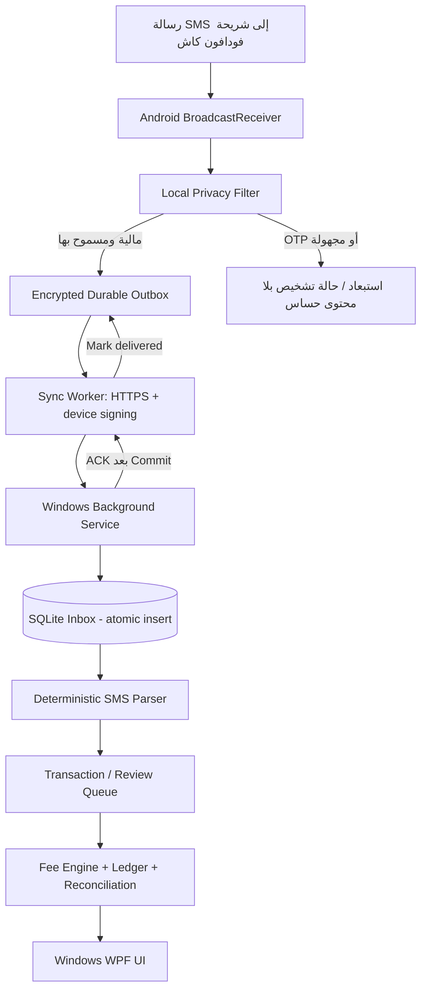
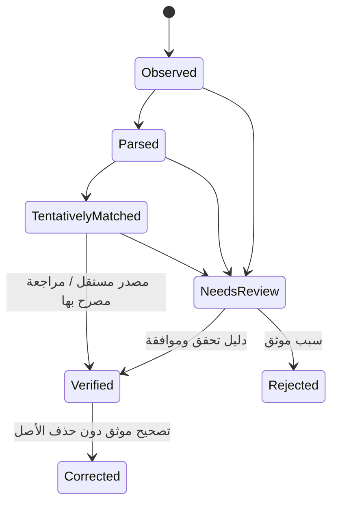

# Wallet Manager + Wallet Receiver
## Technical Blueprint v1.0 — Windows Native + Android SMS Capture

**تاريخ إعداد المخطط:** 27 أكتوبر 2026  
**حالة الوثيقة:** Architecture / Implementation-ready Blueprint — ليست كودًا مكتملًا أو اعتمادًا إنتاجيًا  
**النطاق:** شريحة Vodafone Cash واحدة في V1، مع قابلية إضافة محافظ وأجهزة متعددة لاحقًا  
**أسماء عمل مؤقتة:** `Wallet Manager` (Windows) و`Wallet Receiver` (Android)

> **تنبيه أساسي:** رسالة SMS هي إشعار *مرصود* وليست إثبات تسوية مالية. لا يُسمح بتأكيد إتمام تحويل أو زيادة رصيد عميل تلقائيًا استنادًا إلى SMS وحدها. التأكيد يحتاج مطابقة مصدر موثوق مستقل أو مراجعة مخولة بسجل أدلة.

---

## 0. القرارات المعتمدة (ADRs)

| رقم | القرار | المبرر |
|---|---|---|
| ADR-001 | الاستفادة من [capcom6/android-sms-gateway](https://github.com/capcom6/android-sms-gateway) بعمل Fork مثبت الإصدار، لا نسخه بالكامل كصندوق أسود | تفادي إعادة بناء استقبال SMS والطوابير من الصفر مع الاحتفاظ بإمكانية المراجعة |
| ADR-002 | استهداف `v1.77.4` كخط أساس **مستقر** للمراجعة، ومقارنة `v1.77.5` الـpre-release قبل اعتماد آلية Receiver | إصدار ما قبل الإطلاق يحتوي تغييرًا في تسجيل مستقبل الرسائل؛ يجب التحقق على هاتف فعلي |
| ADR-003 | Android: Kotlin + Jetpack Compose + Room + WorkManager | تطبيق Native وخدمات واضحة للتخزين والمزامنة |
| ADR-004 | Windows: C#/.NET 10 + WPF + MVVM | برنامج Windows .exe أصلي بواجهة RTL عصرية وسهولة توزيع؛ WinUI 3 بديل مستقبلي وليس شرطًا لـV1 |
| ADR-005 | خدمة استقبال منفصلة تعمل كـWindows Service باستخدام .NET Worker + Kestrel | استقبال المعاملات حتى مع غلق نافذة البرنامج، ما دام جهاز Windows شغالًا |
| ADR-006 | SQLite محلية + EF Core migrations + SQLite WAL؛ مستخدم Windows أساسي واحد في V1 | لا حاجة لـPostgreSQL أو سيرفر خارجي في نسخة سطح المكتب؛ تعدد المواقع لاحقًا قد يستلزم نقل قاعدة البيانات |
| ADR-007 | اتصال Android → Windows عبر HTTPS مُتحقَّق منه + ربط QR + مفاتيح منفصلة لكل جهاز | بيانات مالية حساسة؛ لا HTTP صريح على الشبكة المحلية للإنتاج |
| ADR-008 | وصول «مرة واحدة على الأقل» (at-least-once) + Idempotency على جانبي الاتصال | إعادة الإرسال متوقعة ولا يجب أن تنشئ معاملتين |
| ADR-009 | Filtering على Android **قبل الشبكة والتخزين الدائم قدر الإمكان** | تقليل احتمال تسريب OTP ورسائل غير متعلقة بالمحفظة |
| ADR-010 | المعالجة المالية حتمية ومراجعة، ولا LLM في دورة إثبات الأموال | صحة الحسابات والأمان أهم من استخدام الذكاء الاصطناعي |
| ADR-011 | معاملات ومحافظ متعددة مستقبلًا عبر `ProviderAdapter` | فصل قالب Vodafone Cash عن كل بقية النظام |
| ADR-012 | التطبيقان لا يحتاجان سحابة إلزامية | التشغيل على شبكة محلية مع خيار VPN مؤمن إذا تباعد المكانان |

### واقع المشروع المصدر المفتوح

- **الرابط:** https://github.com/capcom6/android-sms-gateway
- **الرخصة:** Apache-2.0. احتفظ بملفات `LICENSE` و`NOTICE` إن وجدت، وبإشعارات حقوق المؤلف وبيّن التعديلات وراجع تراخيص التبعيات والأصول المستخدمة.
- **وضع البناء:** المشروع الأصلي تطبيق Android متعدد الوحدات، وليس مكتبة Core رسمية مستقلة. لذلك الاستخراج عمل هندسي يحتاج اختبارًا وقراءة للشيفرة في الإصدار المثبت.
- **إصدارات مستندة إلى تحقق بتاريخ الوثيقة:** `v1.77.4` منشور باعتباره Latest stable، و`v1.77.5` مصنف pre-release؛ لا ترفع الإصدار تلقائيًا إلى `master` أثناء التنفيذ.
- **وظائف مثبتة في وثائق المشروع:** استقبال `sms:received`، Webhooks، توقيع HMAC، إعادة محاولة التسليم، عرض طابور Webhooks، رسائل متعددة الأجزاء، وواجهات Inbox/Refresh.
- **ملاحظة بخصوص الدقة:** أسماء بعض الوحدات ومسارات المصدر أدناه مفاهيم *يجب ربطها فعليًا بالشيفرة بعد عمل Fork*؛ لا تعتبر قائمة ملفات مؤكدة قبل تدقيق شجرة المصدر.

---

## 1. نطاق المنتج

### V1 — مطلوب
1. تطبيق APK يلتقط رسائل SMS على شريحة استقبال مخصصة لفودافون كاش.
2. يصنف الرسالة محليًا؛ يرسل **إشعارات مالية مطابقة للقواعد فقط**؛ يستبعد OTP/PIN والرسائل غير المعروفة.
3. طابور إرسال مشفّر ومتين، يتعافى من انقطاع Wi-Fi أو إغلاق الكمبيوتر.
4. ربط هاتف واحد أو أكثر بتطبيق Windows من خلال QR وموافقة المستخدم.
5. خدمة Windows تستقبل البيانات وتكتبها بصورة دائمة دون اعتماد على نافذة الواجهة.
6. استخراج نوع الإشعار والمبلغ والمرجع ورقم الطرف الآخر إذا وجد وتسجيل النص الأصلي المالي بصلاحية مقيدة.
7. سجل معاملات، بحث وتصفية، حالات معالجة ومراجعة، سجل تدقيق لا يمحى بالحذف المعتاد.
8. محرك رسوم قابل للتعديل: 50 جنيه رسوم خدمة لكل 1,000، و10 جنيه تكاليف فعلية لكل 1,000، وصافي 40 جنيه لكل 1,000؛ الإعدادات **افتراضية وليست وصفًا لسياسة شبكة فودافون**.
9. التقارير حسب اليوم، الشهر، فترة مخصصة، نوع العملية، والمحفظة؛ تصدير CSV/Excel.
10. نسخ احتياطية مشفرة مع اختبار استعادة، مراقبة الجهاز وطابور المزامنة.

### خارج V1
- تنفيذ التحويلات أو السحب تلقائيًا أو التحكم في PIN/USSD.
- قراءة أو تخزين أكواد التحقق ومعلومات سرية غير لازمة.
- إعلان «الدفع مؤكد» فقط لأن الموبايل تلقى رسالة.
- نظام محاسبي عام متعدد الفروع أو مزامنة سحابية معقدة.
- مساعد LLM يتخذ قرارات محاسبية تلقائيًا.

---

## 2. البنية العامة



**النقل الأولي:** الهاتف والكمبيوتر على نفس Wi-Fi/LAN. الهاتف هو الطرف الذي **يبدأ** الاتصال بنقطة استقبال محلية في Windows. لا يحتاج الكمبيوتر الوصول مباشرة لصندوق رسائل Android في المسار الطبيعي.

**التشغيل خارج LAN:** VPN خاص أو Relay تحت إدارتنا عند الحاجة لاحقًا؛ لا نفتح منفذ خدمة غير محمي على الإنترنت.

### لماذا Windows Service مستقلة؟
- واجهة WPF يمكن فتحها وإغلاقها؛ الـWindows Service تستمر.
- عند Sleep/Shutdown تتوقف الخدمة فعليًا، وتستمر رسائل Android في الطابور إن وصلت للهاتف.
- الاتصال بين WPF والخدمة يتم عبر Named Pipes محمية بـACL أو localhost authenticated IPC؛ **لا** تتشارك الواجهة ملف SQLite بالكتابة دون تنظيم.

---

## 3. Android APK: المكونات والمسؤوليات

| الوحدة المقترحة | الوظيفة | المصدر |
|---|---|---|
| `sms-capture` | استقبال Broadcast النظام وتجميع الرسائل متعددة الأجزاء | تكييف من كور SMSGate بعد فحص الكود |
| `privacy-filter` | تمييز المصدر والقوالب المصرح بها ومنع OTP/PIN | **جديد** |
| `outbox` | تخزين مشفر للرسائل المالية قبل الإرسال، تأكيد ACK، فشل نهائي | إعادة استعمال/تكييف queue موجودة بعد التدقيق |
| `sync-client` | HTTPS + authentication + backoff + jitter + retry | تكييف من محرك Webhooks |
| `pairing` | مسح QR والثقة بشهادة Windows وربط هوية الهاتف | **جديد** |
| `diagnostics` | حالة الصلاحيات، عدد المنتظر، آخر تزامن، آخر خطأ | **جديد/تكييف** |
| `ui` | حالة الاتصال، الطابور، الأجهزة المرتبطة، الخصوصية والإعدادات | **واجهة جديدة** |

### دورة استقبال الرسالة

1. Android يسلم `SMS_RECEIVED_ACTION` للتطبيق **إذا كانت الصلاحيات تسمح على نسخة الجهاز**؛ عدم اختيار التطبيق كتطبيق SMS افتراضي قد يكون ممكنًا لكن يُختبر فعليًا.
2. فك SMS parts بترتيب صحيح؛ تطبيع الأرقام العربية والإنجليزية وتنسيقات المسافات.
3. Filter عالي الحساسية: رفض OTP / PIN / رمز تأكيد / كود سري أولًا، ثم قاعدة إيجابية صريحة لقوالب الإشعارات المالية المعروفة.
4. رسالة لا تطابق سياسة الرسائل المالية = **لا تُرسل ولا يُحفظ نصها في قاعدة البيانات الخاصة بنا**؛ يمكن إظهار عداد عام للرسائل المستبعدة فقط.
5. المسموح: إضافة حدث إلى قاعدة `outbox` المحلية في معاملة واحدة مع `eventId` ثابت و`sequenceNumber`.
6. تشغيل worker قصير للإرسال؛ اعتمد WorkManager للتعافي/إعادة المحاولة؛ لا تعتبر WorkManager ضمانًا لتشغيل فوري ودائم تحت كل قيود OEM.
7. لا حذف من الطابور حتى ACK من Windows بعد نجاح تخزينه؛ الاحتفاظ بأثر تشخيصي غير حساس بعد التسليم.

### صلاحيات Android المستهدفة
- `RECEIVE_SMS`: مطلوبة — صلاحية خطرة/مقيدة يجب التأكد من منحها واستمرارها على الجهاز وإصدار Android المستهدف.
- `INTERNET`: مطلوبة لإرسال HTTPS.
- `ACCESS_NETWORK_STATE`: إذا لزم مراقبة نوع الاتصال.
- `READ_SMS`: **غير مطلوبة في المسار الحي V1**؛ تُضاف فقط عند اعتماد وظيفة استعادة الرسائل القديمة وبموافقة محددة، وبعد اختبار التوافق.
- **لا** `SEND_SMS` ولا `RECEIVE_MMS` ولا صلاحيات جهات اتصال أو إشعارات عامة بدون ضرورة مثبتة.
- أي بقايا صلاحيات من Fork الأصلي يجب إزالتها من manifest النهائي والتحقق من merged manifest.

> **خطر مهم:** `RECEIVE_SMS` صلاحية Hard Restricted وفق وثائق Android؛ قد يؤثر مصدر تثبيت APK وسياسة جهاز Android على القدرة على منحها. اعمل proof-of-concept على **الموديل ونظام التشغيل الحقيقيين** قبل الاستثمار في بقية التطوير. وكذلك اختبر قيود البطارية/الخلفية وعدم ضمان وصول كل أنواع SMS، خصوصًا الرسائل الحساسة.

### أوضاع Android UI — بسيطة جدًا
1. **الرئيسية:** حالة الاتصال (متصل/غير متصل)، حالة استقبال SMS، آخر مزامنة، عدد الرسائل المرسلة/المعلقة/الفاشلة، زر «مزامنة الآن».
2. **الطابور:** قائمة معرفات مختصرة، أوقات، حالات، إعادة إرسال يدوي؛ لا تعرض OTP أو نصوص حساسة.
3. **الربط:** مسح QR، اسم الكمبيوتر، بصمة الشهادة، حالة الثقة، فصل الجهاز.
4. **الإعدادات والتشخيص:** الصلاحيات، استثناء توفير البطارية بموافقة المستخدم، سياسة التصفية، معلومات الإصدار، سجل أخطاء منقّح.

---

## 4. اتصال Android ↔ Windows: بروتوكول V1

### 4.1 QR Pairing

- Windows Service تنشئ شهادة TLS محلية (لـhostname/IP المناسب) وتعرض البصمة العامة `SPKI SHA-256`.
- نافذة Windows تولد تذكرة Pairing عشوائية، **مرة واحدة**، صالحة دقيقتين؛ يُخزن Hash التذكرة فقط.
- QR يحتوي: `schema_version`, `endpoint`, `certificate_spki_sha256`, `pairing_ticket`, `expires_at`، بدون أسرار دائمة.
- الهاتف يعرض اسم الكمبيوتر والبصمة قبل الموافقة؛ ينشئ معرّف جهاز محلي ومفتاحًا محميًا في Android Keystore قدر المستطاع.
- طلب `POST /v1/pair` عبر HTTPS مع **التحقق من البصمة**، والتذكرة. نجاحه يربط الجهاز ويصدر credential طويلة نسبيًا محفوظة بأمان؛ تدوير وإلغاء من Windows.
- لكل جهاز مفتاح مختلف؛ يلزم إعادة ربط بعد فقد مفاتيح الهاتف.

### 4.2 صيغة الحدث (تصميمنا الخاص، وليست صيغة SMSGate الرسمية)

```json
{
  "schemaVersion": 1,
  "eventId": "019c4e29-9e77-7a40-8c1b-f3ae0d56b0fa",
  "deviceId": "phone_01",
  "sequenceNumber": 1024,
  "walletId": "vf_wallet_01",
  "eventType": "financial_sms_observed",
  "receivedAt": "2026-10-27T12:30:00+03:00",
  "senderLabel": "ALLOWED_FINANCIAL_SENDER",
  "simSlot": 1,
  "message": "[SYNTHETIC FINANCIAL SMS, NOT A REAL PROVIDER TEMPLATE]",
  "contentHash": "sha256_hex_of_canonical_allowed_content",
  "parserProfileVersion": "vf-eg-1"
}
```

**ممنوع في أمثلة الاختبار:** بيانات محفظة حقيقية، PIN، OTP أو أرقام هواتف كاملة. عند التطبيق النهائي `message` يحتوي **النص المالي المقبول فقط**، ويُشفّر في التخزين.

### 4.3 واجهات خدمة Windows

| Method | Endpoint | وظيفة |
|---|---|---|
| `POST` | `/v1/pair` | ربط مؤقت عبر تذكرة قصيرة الصلاحية |
| `POST` | `/v1/events` | قبول دفعة أحداث مالية مع منع التكرار |
| `GET` | `/v1/sync/status` | آخر `acceptedSequence` والتأكيدات |
| `POST` | `/v1/device/heartbeat` | حالة الجهاز والصلاحيات والطابور؛ دون نصوص SMS |
| `POST` | `/v1/device/unpair` | إلغاء ربط بموافقة مخولة |
| `GET` | `/v1/health` | داخل LAN، معلومات محدودة ومحمية |

**توقيع مقترح:**
- `X-Device-Id`, `X-Timestamp`, `X-Nonce`, `X-Event-Id`, `X-Signature`.
- `HMAC-SHA256(deviceSecret, METHOD + PATH + TIMESTAMP + NONCE + SHA256(rawBody))` مع صيغة canonical محددة في اختبارات مشتركة؛ تحقق ثابت الزمن + حد انحراف الساعة + nonce replay cache.
- الاتصال يرفض شهادة TLS غير متطابقة؛ لا نُعطِّل شهادة TLS بحجة أن الشبكة محلية.
- `POST /v1/events` يرد `200/201` مع قائمة `acceptedEventIds` و`duplicateEventIds` فقط **بعد commit ناجح** في SQLite.
- `5xx` أو timeout → Android يعيد الإرسال؛ `401/403` → وقف وإشعار بضرورة إعادة الربط؛ `400` للقالب غير الصحيح → quarantine محلي ولا فقد صامت.
- نفذ backoff محدودًا متزايدًا + jitter، مع محاولات طويلة المدى إلى حين قرار مستخدم واعٍ، ومراقبة حجم الطابور.
- **الضمان الواقعي:** at-least-once delivery أثناء بقاء الحدث في outbox؛ لا ضمان لمحتوى SMS لم يصل أصلاً لنظام Android.

### 4.4 منع التكرار والرسائل الفائتة

- `UNIQUE(device_id,event_id)` لكل حدث نقل.
- `UNIQUE(wallet_id,provider_reference)` عندما يتأكد أن المرجع صالح وغير فارغ؛ مع منع إعادة استعمال مرجع معاملة مؤكدة.
- `sender + normalized_content + timestamp_window` مؤشر تطابق ثانوي، **وليس** مفتاح رفض مطلقًا؛ المعاملات المتشابهة قد تكون حقيقية.
- احتفظ بـ`sequenceNumber` متزايد على الجهاز؛ اكتشاف الفجوات يطلق تنبيه، ثم إعادة إرسال من الطابور.
- الرسائل التي لم تُلتقط في Android أصلًا لا يمكن للتطبيق تعويضها بدون `READ_SMS`/وصول لصندوق SMS ونافذة backfill، أو مطابقة من سجل المحفظة المستقل.

---

## 5. Windows Native: خدمات وشاشات

### بنية العملية

```text
Windows Service (WalletManager.Receiver.Service)
  ├── HTTPS listener / pair / device auth
  ├── durable inbox writer + deduplication
  ├── parser & transaction projector
  ├── reconciliation / monitoring
  └── local IPC for WPF UI

Windows Desktop (WalletManager.Desktop.exe)
  ├── dashboard
  ├── transactions and manual review
  ├── withdrawal calculator and fee rules
  ├── period reports
  ├── paired devices and diagnostics
  └── settings, backup, restore
```

### واجهة Windows — أولويات RTL

**A. الرئيسية:** أربعة كروت كبيرة: إجمالي الوارد المرصود، إجمالي الصادر المرصود، رسوم الخدمة، صافي الربح المحقق/المراجع. شريط فترة: اليوم / الأسبوع / هذا الشهر / مخصصة (من/إلى). حالة الهاتف والاتصال في الأعلى. أزرار كبيرة: «عملية جديدة»، «حساب الربح»، «التقارير»، «الأجهزة».

**B. المعاملات:** جدول RTL قابل للبحث، وفرز، مع أعمدة (التاريخ، المحفظة، الاتجاه، المبلغ، الطرف الآخر مخفي جزئيًا، المرجع، المصدر، الحالة). تفاصيل جانبية للرسالة المالية الأصلية بصلاحية وتسجيل كل فتح حساس.

**C. الحساب والرسوم:** آلة حاسبة كبيرة للعمليات اليدوية، وإعدادات رسوم الخدمة وتكلفة السحب الفعلية، ومعاينة فورية وصافي الربح. خيار تطبيق «نسخة رسوم» بتاريخ سريان؛ لا إعادة حساب تاريخ سابق دون أمر صريح وAudit.

**D. تقارير فترة:** اختيار تاريخ بداية ونهاية ومحددات النوع/المحفظة/الحالة، بطاقات إجماليات، رسم بياني، جدول تفصيلي، تصدير PDF/CSV/Excel حسب التطوير (في V1 CSV/Excel فقط).

**E. الأجهزة:** الهاتف، آخر اتصال، آخر SMS مالية، آخر ACK، عدد pending، صلاحية SMS، آخر نسخة تطبيق؛ زر إعادة الربط وتعطيل الجهاز.

**F. التسويات:** «رسالة واردة»، «مطابقة مبدئية»، «تحتاج مراجعة»، «مطابقة مع مصدر موثوق»، «تصحيح/إلغاء»؛ ملاحظة المدقق ومرجع المستند، وتوقيع مستخدم.

**G. الإعدادات:** قواعد رسوم، مستخدمون (V1 محلي)، قفل دخول، نسخ احتياطي، استعادة، سياسات خصوصية واحتفاظ، تغيير شهادة ومفاتيح الاتصال.

### النمط المرئي
- عربي RTL كامل، خطوط مقروءة مثل Segoe UI مع خط عربي متوافق عند الحاجة؛ لوحة حديثة من الأحمر/الأبيض/الرمادي الداكن.
- تجنب استخدام الشعارات الرسمية والادعاء بأنه برنامج مقدم من Vodafone دون إذن؛ الاسم الداخلي مستقل ويمكن كتابة «متوافق مع رسائل Vodafone Cash» حيث يُسمح.
- مناطق لمس كبيرة 44–52px، أزرار واضحة، كثافة نص قليلة، تبويب بسيط، تباين معقول ودعم الوضع الداكن.
- محتوى الويرفريم سيشتق من هذه الشاشات بعد تثبيت البيانات الفعلية.

---

## 6. النموذج المالي: الرسوم والأرباح

### 6.1 التفسير الافتراضي — قابل للتغيير

المطلوب: **50 جنيه رسوم خدمة لكل 1,000 جنيه**، **10 جنيه تكلفة سحب فعلية لكل 1,000 جنيه**، **40 جنيه صافي ربح لكل 1,000 جنيه**.

لعملية خدمة سحب مُؤهَّلة بمبلغ `A` جنيه:

```text
service_fee = round_money(A × 50 / 1000)
atm_cost    = round_money(A × 10 / 1000)
net_profit  = service_fee - atm_cost
```

**مثال:** `A=5000` → `250` رسوم خدمة - `50` تكلفة فعلية = `200 جنيه` صافي ربح.  
**مثال:** `A=1500` → `75` - `15` = `60 جنيه`.  
**مثال:** `A=1000` → `50` - `10` = `40 جنيه`.

- الافتراضي الحساب **النسبي Pro Rata**، وليس التقريب إلى ألف كامل. أضف `calculation_mode` لدعم: `PRO_RATA` و`CEIL_PER_1000` و`FIXED_PER_TXN`، ولا تغيّر القاعدة دون موافقة المستخدم.
- احفظ النقود كـ**عدد صحيح من القروش** (`amount_piasters`)؛ التقريب `HALF_UP` للقروش فقط، واحفظ ناتج كل جزء منفصلًا.
- لا تفترض أن **كل رسالة تحويل وارد** تستحق رسوم خدمة؛ يحدد نوع العمل الموثق `CASH_OUT_SERVICE`, `TOP_UP`, `TRANSFER`, `ATM_WITHDRAWAL`, `MANUAL_ADJUSTMENT` إلخ.
- تكاليف ATM قد تكون عملية مستقلة تختلف زمنيًا عن عملية العميل؛ في V1 يمكن استخدام **تكلفة معيارية تقديرية**، لكن اظهر فرق التكلفة المعيارية مقابل **التكلفة الفعلية المسواة** عندما تتوفر بياناتها.
- احتفظ بـ`fee_rule_version` و`effective_from` و`fee_basis` لكل عملية قابلة للفوترة؛ تعديل 50/10 لا يعيد كتابة أرباح تاريخية.
- الدفاتر تفرق بين `provisional_profit`, `verified_profit`, `actual_expense`؛ لا تخلط الربح المتوقع مع النقد المتاح أو رصيد المحفظة.

### 6.2 تقرير الفترة

```text
Observed Incoming (SMS-based)
Observed Outgoing (SMS-based)
Eligible Service Principal (confirmed service transactions)
Gross Service Fees (sum of frozen fee snapshots)
Estimated Withdrawal Costs
Actual Settled Withdrawal Costs
Net Estimated Profit = Gross Fees - Estimated Costs
Net Verified Profit  = Verified Gross Fees - Actual Settled Costs
Unverified / Unmatched Transactions Count
```

> تحديد قيود المحفظة والنقد الفعلي يستلزم تعريف «تدفق العملية» بالضبط قبل اعتماد دفتر قيد مزدوج. التصميم لا يفرض اتجاه قيد خاطئ لمجرد وجود SMS. سنضيف `ledger_entries` بأزواج قيود متوازنة فقط بعد تثبيت نموذج العمليات الواقعي، ولا نعتبر `wallet_balance_from_sms` الرصيد المعتمد.

---

## 7. حالات المعاملات



- `Observed`: التقطنا رسالة مالية فقط.
- `Parsed`: تحليل رسالة ناجح بقواعد معرّفة.
- `TentativelyMatched`: تشابه مع طلب / سجل، **غير مؤكد ماليًا**.
- `NeedsReview`: غموض أو نقص بيانات أو تكرار محتمل.
- `Verified`: مستند أو مصدر مستقل موثوق + سجل تحقق ومستخدم مخول، أو Webhook رسمي موثق.
- `Corrected`: قيد تصحيح منفصل مرتبط بالأصل؛ لا حذف صامت.

---

## 8. قاعدة البيانات — مخطط منطقي أولي

| الجدول | الحقول الجوهرية | قيود وتفاصيل |
|---|---|---|
| `devices` | id, name, status, cert_pin, credential_version, last_seen_at, last_sequence | منع أرقام الهواتف الكاملة في اللوحات |
| `wallets` | id, provider, masked_msisdn, linked_device_id, active | عدة محافظ مستقبلًا |
| `inbox_events` | id, device_id, event_id, sequence, received_at, encrypted_body, sender_label, hash, accepted_at | unique(device_id,event_id), append-only-ish |
| `parsed_messages` | id, inbox_id, parser_version, parse_status, normalized_fields_json, warnings | إعادة التحليل تعطي نسخة جديدة بدل تعديل أصل بلا أثر |
| `transactions` | id, wallet_id, event_id, type, amount_piasters, reference, counterparty_masked, status | مرجع المحفظة يفحص الازدواج، مع السماح بالقيم الفارغة |
| `fee_rules` | id, fee_piasters_per_1000, cost_piasters_per_1000, mode, effective_from, created_by | إصدار غير قابل للتعديل بعد استخدامه |
| `fee_snapshots` | id, transaction_id, fee_rule_id, base_piasters, charged_piasters, estimated_cost_piasters, estimated_profit_piasters | التاريخ ثابت/قابل للتدقيق |
| `reconciliations` | id, transaction_id, evidence_type, evidence_reference, decision, verified_at, verified_by | صلاحيات وملاحظات |
| `ledger_entries` | id, journal_id, account_id, debit_piasters, credit_piasters, created_at | يؤجّل تفعيله حتى تعريف cash flows ثم يفرض التوازن |
| `audit_log` | id, user_id, action, record_type, record_id, before_hash, after_hash, happened_at | append-only؛ مع حماية من تعديل قاعدة البيانات محليًا |
| `app_users` | id, login, password_hash, role, disabled_at | أدوار Admin / Operator / Auditor |
| `backups` | id, path, created_at, status, checksum, encryption_info | اختبار استعادة |

**SQLite migrations:** أنشئ `schema_migrations` بواسطة EF Core؛ تجنب الكتابة المتزامنة من نافذة Windows والخدمة؛ واجهة WPF تتعامل مع خدمة محلية مرخصة.

**الخصوصية:** `encrypted_body` بنص مالي مقبول فقط؛ تشفير عمود/صف بمفتاح مخزن محميًا بـWindows DPAPI، وعدم وضع أسرار المفاتيح في نفس مجلد النسخ الاحتياطية غير المشفرة. يمكن اختيار SQLCipher لاحقًا بعد مراجعة التراخيص والتوزيع.

---

## 9. سياسة الأمان والخصوصية

1. **مبدأ الحد الأدنى:** استقبال SMS فقط، لا إرسال رسائل ولا وصول جهات الاتصال.
2. **عدم استخراج OTP:** حد سلبي أولًا + قواعد إيجابية واضحة؛ لا تُرسل SMS مجهولة للمراجعة في Windows إلا بعد موافقة محددة ومراجعة خصوصية.
3. **تشفير أثناء النقل:** HTTPS مع certificate/SPKI pinning؛ لا `trustAllCerts`, ولا bypass TLS.
4. **المصادقة:** مفاتيح خاصة بكل جهاز، إبطال، تدوير، replay prevention، rate limiting.
5. **قاعدة البيانات:** صلاحيات ملفات Windows، DPAPI/Keystore، password hashes بآلية مناسبة، سجلات منقّحة.
6. **حسابات مستخدمين:** Admin وOperator وAuditor؛ فتح نص رسالة أصلية أو تصحيح معاملة يستلزم إذنًا.
7. **مصدر SMS:** اسم المرسل **ليس برهانًا** على صحة الجهة المالية؛ يمكن تزوير الرسائل في بعض السيناريوهات.
8. **الثبات:** لا استخدام SMS لتأكيد أرصدة العملاء تلقائيًا، ولا تسويات دون دليل.
9. **التحديثات:** APK موقّع بمفتاح إصدار منفصل محمي؛ توقيع حزم Windows والتحقق من الناشر إن أمكن.
10. **خدمات خارجية:** لا Firebase/Cloud/Crashlytics/analytics في النسخة النهائية إلا إذا جرى تدقيق تبعياتها وموافقة المستخدم الصريحة.
11. **العلامات التجارية:** لا استخدام شعار Vodafone الرسمي دون تصريح؛ يمكن استعمال اسم المنتج في سياق وصف التوافق غير المضلل.
12. **الاحتفاظ:** سياسة احتفاظ محددة للبيانات الشخصية والرسائل؛ أدوات حذف آمن ضمن القيود المحاسبية/القانونية.

### Threat model مبسط

| خطر | إجراء تخفيف |
|---|---|
| رسالة مزيّفة من اسم مرسل شبيه | عدم اعتماد SMS كإثبات دفع؛ reconciliation مستقلة |
| مهاجم على Wi-Fi | TLS pinning + مصادقة جهاز + replay prevention |
| استقبال بيانات حساسة | تصفية *قبل الإرسال* + عدم logging خام |
| انقطاع/تغيير IP | طابور محلي، Retry، إعادة اكتشاف مصرح بها، تعافي بعد reboot |
| تسليم مزدوج | `UNIQUE(device_id,event_id)` + منع duplicate financial reference |
| فقد جهاز الهاتف | revoke credentials وإعادة Pairing للهاتف البديل |
| سرقة نسخة بيانات | backup encryption + مفاتيح منفصلة + ACL |
| التلاعب بتقارير الأرباح | fee snapshots ثابتة + Audit + حسابات بالقروش |

---

## 10. الموثوقية والمراقبة

**أهداف تشغيلية مبدئية تُقاس بالتجربة، وليست ضمانات:**
- كل حدث مالي يصل إلى Android receiver ويلتزم بالشروط يُكتب محليًا كتابة durable قبل أي محاولة شبكة.
- لا تضيع الأحداث عند فصل Wi-Fi لمدة 24–48 ساعة ما دام الهاتف ومساحة التخزين بحالة جيدة والرسالة التُقطت.
- يتعافى طابور الإرسال بعد reboot Android وإعادة تشغيل خدمة Windows.
- لا تتكرر المعاملة المالية مهما أعيد إرسال `eventId`.
- تنبيه عند غياب نبضات الجهاز 5 دقائق (إذا كان نمط heartbeat الدقيق ممكنًا مع سياسات طاقة الهاتف) أو تضخم الطابور، والتنبيه منفصل عن إيقاف المحاسبة.

**قواعد عملية:**
- heartbeat مضبوطة بشكل يحترم قيود Android، وقياس last_seen عند كل إرسال ناجح؛ عدم إرسال heartbeat بدقة غير مضمونة بشكل مضلل.
- queue backpressure (مثال حد آمن 5,000 رسالة مالية) مع مراقبة نسبة التخزين؛ لا حذف صامت للرسائل غير المُسلَّمة.
- عند فقد الاتصال يُعرض مؤشر أحمر في Windows وآخر نجاح؛ لا يُعرض «متصل» إلا بناء على heartbeat أو طلب حديث موثوق.
- دعم backfill اختياري منفصل للرسائل القديمة بعد طلب `READ_SMS` والتأكد من عدم استرجاع أكواد حساسة.

---

## 11. الاختبارات ومعايير القبول

### Android
- [ ] يجتاز فحص صلاحية `RECEIVE_SMS` على الهاتف المستهدف مع التثبيت الفعلي للـAPK.
- [ ] التقاط SMS عادية ورسالة عربية طويلة متعددة الأجزاء دون فقد أو دمج خاطئ.
- [ ] فلترة OTP/PIN قبل تخزين/إرسال المحتوى؛ فحص logs وnetwork capture بأحداث اصطناعية.
- [ ] رفض الرسائل غير المالية حتى لو شاركت كلمات عامة مثل «رصيد».
- [ ] Offline 48h + إعادة التشغيل + عودة الشبكة: أحداث اختبار معرّفة تصل بلا فقد ولا ازدواج.
- [ ] بقاء outbox بعد force stop/reboot ضمن حدود Android الفعلية وبيانات عدم التشغيل واضحة للمستخدم.
- [ ] بطارية/Doze/OEM restrictions وتجربة هاتفين حقيقيين (واحد Android حديث).
- [ ] إزالة SEND_SMS وMMS والتبعيات السحابية غير المطلوبة من الـmerged manifest والـAPK النهائي.

### Windows
- [ ] Windows Service تعمل بعد reboot تلقائيًا حسب إعدادات خدمة النظام.
- [ ] نافذة WPF مغلقة والتزامن ما زال يعمل.
- [ ] استقبال 1,000 حدث اصطناعي وإعادة إرسال كل حدث ثلاث مرات؛ كل معرف يتحول إلى سجل Inbox واحد.
- [ ] محاكاة فشل قاعدة البيانات → لا ACK كاذب؛ recovery بعد استعادة التخزين.
- [ ] اختبار إبطال جهاز، شهادة غير معروفة، مفتاح خاطئ، replay، nonce مكرر، clock skew.
- [ ] النسخ الاحتياطي والاستعادة على جهاز Windows مختلف بعد توفير مفتاح النسخة بشكل آمن.
- [ ] عرض RTL صحيح على دقات 1366×768 و1920×1080 وتكبير Windows 125/150%.

### مالية
- [ ] قاعدة افتراضية 1000: 50 رسوم، 10 تكلفة، 40 صافي.
- [ ] 5000: 250، 50، 200.
- [ ] 1500: 75، 15، 60.
- [ ] 999 و1001: اختبار `PRO_RATA` والقروش والتقريب المحدد.
- [ ] تعديل رسوم الخدمة والتكلفة بتاريخ لاحق لا يغير snapshot عمليات سابقة.
- [ ] لا تُحسب أرباح خدمة السحب على «كل وارد» تلقائيًا.
- [ ] اختلاف حساب SMS عن كشف مرجعي يظهر حالة مراجعة لا «مدفوع».
- [ ] تصدير تقرير فترة بحدود زمنية صحيحة حسب Africa/Cairo، مع تخزين UTC في النظام وعرض التوقيت المحلي.

### بوابة اعتماد إنتاجي (Go/No-Go)

لا يتم اعتماد النظام لتسجيل عمليات مالية فعلية إلا بعد: نجاح أجهزة/صلاحيات Android، اختبار أمان، اختبار انقطاع الاتصال والتعافي، اختبار إعادة التسجيل/التكرار، مراجعة قوالب الرسائل الحقيقية بعد إزالة بيانات العملاء، وتجربة تسوية رسمية/مراجعة مستقلة بدون اعتماد SMS وحدها.

---

## 12. هيكل المشروع المقترح

```text
wallet-ops/
├── README.md
├── LICENSES/
│   ├── UPSTREAM-SMSGATE-APACHE-2.0.txt
│   ├── THIRD_PARTY_NOTICES.md
│   └── CHANGES_FROM_UPSTREAM.md
├── docs/
│   ├── architecture/blueprint.md
│   ├── architecture/adr/
│   ├── security/threat-model.md
│   ├── protocol/v1.openapi.yaml
│   ├── finance/fee-policy.md
│   ├── finance/transaction-state-machine.md
│   └── testing/production-gates.md
├── android/
│   ├── app/
│   ├── core-sms/                # adapted/verified from upstream
│   ├── core-privacy-filter/
│   ├── core-outbox/
│   ├── core-sync/
│   ├── core-pairing/
│   ├── feature-dashboard/
│   ├── feature-queue/
│   ├── feature-settings/
│   └── test-fixtures/
├── windows/
│   ├── WalletOps.sln
│   ├── src/
│   │   ├── WalletOps.Desktop/       # WPF + MVVM
│   │   ├── WalletOps.Receiver.Service/ # Windows Service + Kestrel
│   │   ├── WalletOps.Domain/        # core domain + rules
│   │   ├── WalletOps.Application/   # use cases
│   │   ├── WalletOps.Infrastructure/# SQLite, crypto, filesystem
│   │   └── WalletOps.Contracts/     # IPC + API DTOs
│   └── tests/
│       ├── WalletOps.UnitTests/
│       ├── WalletOps.IntegrationTests/
│       └── WalletOps.SecurityTests/
├── protocol/
│   ├── event-envelope.schema.json
│   ├── pairing.schema.json
│   └── test-vectors/
├── scripts/
│   ├── setup-dev.ps1
│   ├── build-release.ps1
│   └── check-dependencies.ps1
└── .github/workflows/
    ├── android-ci.yml
    ├── windows-ci.yml
    └── security-scans.yml
```

**Source strategy:** إبقاء Fork الأصلي في فرع منفصل `upstream-smsgate-pinned` أو مستودع مرجعي، وتوثيق أصل كل ملف معدل (`file origin`, `commit`, `changes`). لا تفترض أن نقل الكود إلى Gradle module مستقل يحافظ تلقائيًا على التبعيات ودورة الحياة؛ اختبارات تكامل إلزامية.

---

## 13. خطة التنفيذ لكودكس — على شكل Epics

### EPIC 0 — Discovery & reproducible build (أولوية حرجة)
- Fork pinned upstream، حفظ SHA للإصدار، تدقيق التراخيص والتبعيات.
- جرد package receiver / incoming / queue / webhook / service lifecycle وAndroidManifest.
- بناء APK أصلي من المصدر مع إصدار Gradle/SDK المستهدفين، تسجيل النتائج وأسباب أي إخفاق.
- اختبار استقبال رسالة اختبار على الجهاز المستهدف؛ التأكد من الصلاحيات والاستيقاظ.
- **Deliverable:** `UPSTREAM_AUDIT.md` + `DEPENDENCY_INVENTORY.md` + proof-of-concept APK + Test Report.

### EPIC 1 — Contracts & financial domain
- تثبيت `event-envelope`, signing spec, idempotency, ACK contract.
- نمذجة حالات المعاملة، صيغ الرسائل، fee rules + test vectors.
- **Deliverable:** Protocol JSON schemas/OpenAPI + unit tests.

### EPIC 2 — Android Collector
- تقليل صلاحيات وميزات SMSGate إلى استقبال فقط.
- implement privacy filter before transmission and durable outbox.
- Android QR pairing, signed HTTPS sync, simple Arabic UI.
- **Deliverable:** Debug APK + instrumentation tests + logs منقحة.

### EPIC 3 — Windows Receiver Service
- Windows worker + Kestrel HTTPS + device auth and revoke.
- SQLite migrations, transactional inbox writes + dedup, local IPC.
- **Deliverable:** Windows Service قابل للتثبيت + CLI integration test.

### EPIC 4 — Financial Engine
- Parser profiles with redacted synthetic fixtures, review workflow, fee calculation, reconciliation statuses.
- **Deliverable:** Domain/Integration tests including rounding and retroactive rule changes.

### EPIC 5 — Desktop UI
- WPF RTL Dashboard + Transactions + Calculator + Reports + Devices + Settings.
- Import/export, user roles and backup restoration.
- **Deliverable:** Signed candidate `.exe` installer with service installer/upgrade path.

### EPIC 6 — Reliability, security, UAT
- 48h offline/replay/fuzz tests, staged real-SIM testing, backup/restore.
- Document accepted gaps, operator runbook, incident actions, production gate.
- **Deliverable:** `UAT_REPORT.md` + `RELEASE_CHECKLIST.md` + `OPERATIONS_RUNBOOK.md`.

### Codex execution rules

1. لا يبدأ بتصميم واجهات قبل استكمال إثبات استقبال SMS وصلاحيات Android.
2. ممنوع اختراع مسارات ملفات upstream أو التساهل في التبعيات؛ اقرأ الملفات وأثبتها قبل أي تعديل.
3. كل feature يقدم اختبارًا آليًا وحالة فشل معروفة.
4. لا تكتب API يجمع الرسائل كلها ثم يفلتر في Windows؛ **فلترة الهاتف شرط أمان**.
5. لا تُنشئ أمثلة SMS حقيقية أو أرقام أشخاص؛ استخدم بيانات اصطناعية.
6. أي تغيير يخص الرسوم/الحالة المالية يحتاج tests وسجل audit.
7. بدون اتصالات سحابية خارجية إلا عند توثيق الحاجة والموافقة.
8. لا ترفع الأسرار أو keystore أو قواعد بيانات حقيقية إلى Git.
9. قبل اعتماد الإنتاج، اعرض ما لا يزال غير موثق أو غير مختبر بوضوح.

---

## 14. أسئلة عمل مفتوحة لا تمنع بناء البنية الأساسية

- **التدفق المحاسبي الدقيق:** عند خدمة سحب 1000، هل العميل يرسل 1000 للمحفظة ويتسلم نقدًا 950، أم يدفع 50 نقدًا زيادة؟ هذا يغيّر دفتر النقد، وإن لم يغيّر **معادلة الربح المعيارية** 50-10=40.
- **الأموال المشمولة:** هل توجد عمولات على الإيداع/التحويل أم على السحب فقط؟ الافتراضي السحب فقط.
- **أساس 50 و10 لكل ألف:** نسبي (افتراضي)، تقريب للألف الأعلى، أم شرط شرائح تجارية؟ يوجد دعم برمجي للسياسات الثلاث، ويتم الاختيار قبل التشغيل المالي الحقيقي.
- **ويندوز:** Windows 10/11 ووجود كمبيوتر واحد دائم التشغيل، وWi-Fi أو Ethernet.
- **هاتف Android:** موديل الجهاز، إصدار Android، SIM واحدة أو مزدوجة، سياسة توفير البطارية.
- **المراجعة:** كشف عمليات المحفظة/بوابة دفع رسمية أو مسار مراجعة مخول مناسب قانونيًا.
- **عدد العمليات:** متوسط عدد SMS اليومي وطول فترة الاحتفاظ الآمن.

---

## 15. مراجع تقنية معتمدة

1. SMSGate GitHub: https://github.com/capcom6/android-sms-gateway
2. Releases: https://github.com/capcom6/android-sms-gateway/releases
3. SMSGate Webhooks: https://docs.sms-gate.app/features/webhooks/
4. SMSGate API: https://capcom6.github.io/android-sms-gateway/
5. Android SMS_RECEIVED_ACTION: https://developer.android.com/reference/android/provider/Telephony.Sms.Intents
6. Android RECEIVE_SMS restricted permission: https://developer.android.com/reference/android/Manifest.permission
7. Android background tasks: https://developer.android.com/develop/background-work/background-tasks
8. Android background optimization: https://developer.android.com/topic/performance/background-optimization
9. .NET Worker Windows Service: https://learn.microsoft.com/en-us/dotnet/core/extensions/windows-service
10. WPF/WinUI platform choice: https://learn.microsoft.com/en-us/windows/apps/get-started/windows-developer-faq

---

## 16. Definition of Done — قرار V1

تُقبل V1 عندما يتوفر **APK موقّع + Windows Installer**، وإتمام الربط QR على الشبكة المحلية، والتقاط إشعار مالي اصطناعي / تجريبي مع قواعد تمنع إرسال OTP، وإعادة تسليم ناجحة بعد انقطاع الاتصال، وسجل معاملات لا يكرر الرسالة، وحاسبة 50/10/40 قابلة للتعديل دون المساس بتاريخ العمليات، وتقرير فترة كامل، ومراجعة مستقلة قبل التحقق المالي، ونسخة احتياطية أمكن استعادتها، وتقرير اختبارات وتهديدات وقيود موثق.

**اقتراح البداية:** ابدأ EPIC 0 ثم EPIC 1. لا يُغيّر هذا المخطط حقيقة أن الرسالة نفسها قد تكون متأخرة أو مزيفة، وأن صحة الأموال لا يثبتها سوى تسوية مستقلة.
