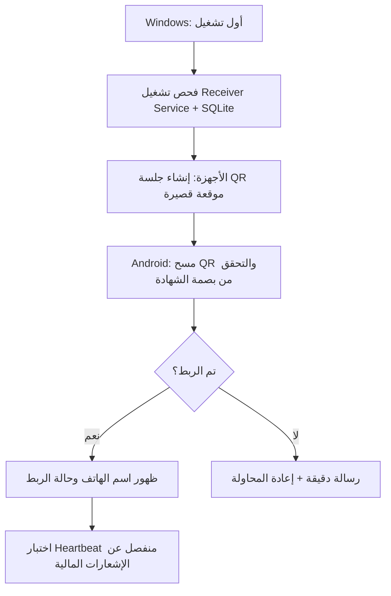
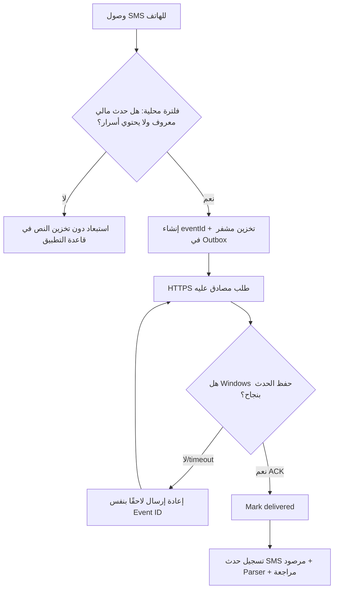

# Wallet Manager / Wallet Receiver — UI/UX Wireframes v1.0

**التاريخ:** 2026-10-27  
**المرحلة:** اعتماد الهيكل والملاحة والتفاعلات، وليس اعتماد تنفيذ إنتاجي  
**المصدر المعماري:** `Wallet_Manager_Receiver_Technical_Blueprint_v1.md`  
**معاينة تفاعلية:** `wallet_wireframes_interactive.html` (HTML محلي مستقل — نموذج UX، **ليس** Windows EXE أو Android APK)  
**لقطات:** `01_dashboard_android.png`, `02_fee_calculator.png`, `03_transactions_android_queue.png`, `04_devices_android_pairing.png`

## 1. هدف التصميم

منتجان متكاملان لا يتداخل دورهما:

1. **Wallet Manager (Windows Native .exe):** نظام مكتبي عربي RTL لإدارة إشعارات المعاملات، التقارير حسب التاريخ، حساب رسوم الخدمات وتكلفة السحب والربح، مراجعة الحالات والتسوية وإدارة أجهزة الاستقبال.
2. **Wallet Receiver (Android APK):** يلتقط إشعارات SMS المالية التي تطابق قواعد سماح محلية، يمنع تصدير OTP/PIN، يحتفظ بأحداث قابلة للإرسال في طابور محمي، ويرسلها إلى خدمة Windows بأمان؛ **لا** يقدم محاسبة ولا يرسل أموالًا.

> **قاعدة تصميم لا يجوز إخفاؤها:** SMS دليل على أن رسالة وصلت إلى الهاتف، لا دليل مستقل على أن الأموال وصلت وسُوّيت. كل إجمالي مبني على إشعارات SMS يجب تمييزه بوضوح بـ«مرصود»؛ وكل ربح غير مبني على مصاريف فعلية مُسوّاة يجب تمييزه بـ«تقديري».

## 2. معلومات بنيوية غير قابلة للتغيير في V1

| قرار | التنفيذ المبدئي |
|---|---|
| نظام سطح المكتب | C# / .NET + WPF/MVVM، RTL، يعمل على Windows 10/11 عند إثبات متطلبات البيئة |
| خدمة الخلفية | Windows Service مستقلة؛ تواصل WPF عبر قناة IPC محمية |
| Android | Kotlin + Jetpack Compose؛ الاستفادة من SMSGate بعد Fork/audit وتثبيت الإصدار |
| التخزين | SQLite للأحداث المالية ومراجعات Windows، وطابور Android مشفّر |
| المصادقة | HTTPS مصادَق عليه + QR pairing + credential فريدة لكل هاتف |
| النموذج المحاسبي | مبالغ صحيحة بالقروش مع `HALF_UP` وتاريخ لنسخ قواعد الرسوم |
| نطاق أول إصدار | شريحة واحدة فودافون كاش، هاتف واحد، كمبيوتر واحد؛ هيكل قابل للتوسعة |
| شبكة العمل | LAN أولًا أو VPN خاصة، وليس Webhook مكشوفًا للعامة |
| الخصوصية | تصفية الرسائل المالية المسموح بها على الهاتف قبل الإرسال، ورفض OTP/PIN أولًا |

## 3. مبادئ الواجهة والنظام البصري

- اللغة: عربي افتراضي واتجاه واجهة `RTL`، مع أرقام/مراجع أو UUID منسقة في مناطق `LTR` لمنع انعكاسها بصريًا.
- هوية: علامة `Wallet Manager` مستقلة، بألوان حمراء مستوحاة من فئة الخدمات المالية **دون نسخ شعار Vodafone التجاري أو الادعاء أن هذا تطبيق رسمي**.
- خط النظام: `Segoe UI` أو خط عربي واضح قابل للتضمين قانونيًا. لا يلزم تحميل خطوط خارجية عند التشغيل.
- قواعد سهلة الاستخدام: عناصر تفاعل ارتفاعها 44–52px على الأقل، كروت سريعة كبيرة، تنقّل يمين الشاشة في Windows، تبويبات سفلية واضحة في Android.
- أيقونات مصحوبة بنص، وتباين لوني واضح؛ الحالة لا تُشرح باللون وحده.
- بطاقات Dashboard أرقام كبيرة، وباقي التفاصيل في شاشة مختصة؛ لا تضيع البيانات المهمة داخل واجهة مزدحمة.
- دعم تكبير واجهة WPF: 100% / 125% / 150%، ودعم حركة لوحة المفاتيح وقراءة الشاشة قدر الإمكان.

### Design Tokens

```yaml
colors:
  brand_red: '#CA1535'
  brand_dark: '#7F102A'
  brand_light: '#FFF0F1'
  positive: '#10895C'
  positive_light: '#E9F8F0'
  warning: '#BC7400'
  warning_light: '#FFF4DD'
  info: '#2562AE'
  surface: '#FFFFFF'
  background: '#F3F5F8'
  border: '#E7EAF0'
  text: '#192336'
  text_muted: '#68748A'
radius_px:
  card: 16
  button: 11
  input: 10
spacing_px: [4, 8, 12, 16, 24, 32]
min_touch_target_px: 44
screen_breakpoints:
  desktop_reference: '1366x768 minimum target, 1600x900 recommended'
  android_reference: '360x800 dp, responsive for 320+ dp'
```

## 4. Information Architecture — Windows

```text
Wallet Manager
├── W01 الرئيسية (Dashboard)
├── W02 المعاملات (Transactions)
│   ├── بحث / فلترة / فرز
│   └── W02-D تفاصيل المعاملة + سجل المراجعة
├── W03 حاسبة الرسوم والأرباح (Fee Calculator)
│   ├── مبلغ الخدمة
│   ├── رسوم الخدمة لكل 1000 ج
│   ├── التكلفة المعيارية لكل 1000 ج
│   ├── طريقة الاحتساب
│   └── نسخة قاعدة رسوم بتاريخ بدء السريان
├── W04 تقارير فترة (Period Reports)
├── W05 المراجعة والتسويات (Reconciliation)
├── W06 الأجهزة والربط (Devices)
│   ├── Health / Heartbeat / Queue
│   └── W06-P QR Pairing Dialog
└── W07 الإعدادات (Settings)
    ├── الأمان والصلاحيات
    ├── النسخ الاحتياطي والاستعادة
    └── الاحتفاظ والخصوصية
```

### W01 — Dashboard

**الغرض:** معرفة ما رُصد خلال فترة محددة بسرعة، وما يحتاج متابعة.

**مناطق الشاشة:** Header (حالة الخدمة، المستخدم) ← شريط فترة (اليوم/آخر 7 أيام/الشهر/مخصصة من وإلى) ← 4 بطاقات KPI ← 4 إجراءات كبيرة ← توزيع العمليات وحالة الهاتف ← آخر المعاملات.

**KPI:**
- الوارد المرصود من SMS؛ **ليس رصيدًا معتمدًا**.
- الصادر المرصود من SMS.
- رسوم الخدمات المراجعة والمؤهلة فقط؛ لا تفرض رسوم تلقائيًا على كل وارد.
- صافي الربح **التقديري** وفق تكلفة معيارية، لا «رصيد نقدي» ولا «ربح نهائي».

**التفاعلات:** تغيير الفترة يعيد تصفية الجدول والإجماليات معًا؛ اختيار بطاقة يفتح شاشة المعاملات مرشحة إذا كان ذلك منطقيًا؛ «الحاسبة» يفتح W03؛ النقر على صف يفتح تفاصيل مقنّعة؛ حالة الجهاز تفتح W06.

**Empty/Failure:** لا معاملات = بطاقات بقيمة 0 ورسالة توضيحية؛ الجهاز غير متصل = تنبيه أعلى المحتوى دون فقد السجل؛ خطأ تحميل = إعادة محاولة + رسالة قابلة للفهم.

### W02 — Transactions

**الغرض:** استعراض كل إشعارات التحويل والعمليات اليدوية وتفسير مصدر كل عملية.

**أعمدة الجدول (RTL):** التاريخ والوقت، الاتجاه، المبلغ، الطرف الآخر بعد الإخفاء الجزئي، مرجع مصدر الإشعار، المحفظة، الحالة، الإجراءات.

**الفلاتر:** نطاق تاريخ، وارد/صادر، حالة، بحث مرجع/رقم/مبلغ، تصنيف العملية (تحويل/خدمة سحب/سحب ماكينة/تسوية يدوية). بحث سريع مع إزالة التشكيل العربي وتوحيد الأرقام عند التنفيذ.

**تفاصيل العملية W02-D:**
- معلومات الحدث الأصلية: `device_id`, `event_id`, `received_at`, مصدر، مرجع، نص مالي منقّح عند توفر صلاحية.
- معلومات التصنيف والمطابقة ونسخة الرسوم وتاريخ الاحتساب.
- حالة المراجعة، مصدر التحقق المستقل، الموظف/المستخدم المراجع، سجل التدقيق.
- لا تعرض زر «تأكيد» قابلًا للتنفيذ دون مستند أو مصدر مستقل وبصلاحية مناسبة.

**States:** `observed`, `parsed`, `tentatively_matched`, `needs_review`, `verified`, `rejected`, `corrected`؛ استخدم ترجمة UI صريحة دون اختصار مضلل.

### W03 — Fee Calculator / Rules

**الغرض:** حساب ربح خدمة السحب وتخصيص القاعدة دون تغيير العمليات التاريخية.

**الافتراضي:** رسوم 50 ج لكل 1000، تكلفة سحب معيارية 10 ج لكل 1000، صافي 40 ج لكل 1000.

```text
amount = 5000.00 EGP
service_rate = 50.00 EGP / 1000
cost_rate = 10.00 EGP / 1000
calculation_mode = PRO_RATA
fee = 250.00 EGP
estimated_cost = 50.00 EGP
estimated_net_profit = 200.00 EGP
```

**طريقة حساب النسب:**

```text
factor = amount / 1000            # PRO_RATA default
fee = round_half_up(factor * service_rate, 0.01)
cost = round_half_up(factor * cost_rate, 0.01)
net = fee - cost
```

- `PRO_RATA` افتراضي؛ `CEIL_PER_1000` اختياري بوضوح؛ `FIXED_PER_TXN` مؤجل حتى اعتماد قواعده.
- الأمثلة المطلوب اجتيازها: 1000→50-10=40؛ 1500→75-15=60؛ 5000→250-50=200.
- الحفظ الإنتاجي يتطلب إظهار ملخص تغييرات («كان → أصبح»)، تاريخ سريان وموافقة، ثم إصدار `fee_rule_version` جديد.
- نسخ الرسوم القديمة مرتبطة بالمعاملات؛ تغيير القاعدة ليس إعادة احتساب تلقائية.
- **تحذير UI:** تكلفة الماكينة الحالية معيارية ما لم تصل تسوية فعلية تؤكدها.
- لا تسمح بقيم سلبية، أو مبلغ 0 كعملية مالية، أو أرقام غير صالحة أو غير قابلة للتمثيل بدقة.

### W04 — Reports

**الغرض:** تجميع المعاملات خلال فترة حسب الوارد والصادر والخدمات المؤهلة والربح.

**مكوّنات:** اختيار فترة واضح ← 4 KPI ← رسم وصفي ← جدول محاسبي ← تصدير CSV/Excel (حسب المرحلة).

**حقول التقرير المستقبلية:** إجمالي الوارد المرصود، إجمالي الصادر المرصود، أصل معاملات الخدمات المؤهلة، رسوم خدمات مؤكدة، التكلفة المعيارية، التكلفة الفعلية المسوّاة، صافي الربح التقديري، الربح بعد تسوية التكاليف، عدد المعاملات المراجعة/المعلقة.

**قواعد:** لا يُعتمد الرسم البياني التجريبي كبيانات مالية. منع احتساب أي إشعار وارد غير مؤهل كخدمة سحب. CSV يحتوي تواريخ واضحة ومبالغ رقمية دون أسرار أو رسائل كاملة تلقائيًا.

### W05 — Review & Reconciliation

**الغرض:** توضيح العمليات التي لا يمكن اعتمادها من SMS وحدها.

**مناطق:** قائمة الحالات، سبب المراجعة، مطابقة مستند/كشف، ملف الدليل، تعليقات، سجل الأحداث، مراجعة مصرح بها. زر «مطابقة» لا يكون متاحًا إلا بمصدر مستقل وسجل تدقيق، ويمكن دعم مراجعة مزدوجة لاحقًا.

**حالات مهمة:** تكرار Webhook ≠ تكرار التحويل؛ عكس العملية بتسوية مصححة لا بحذف الأصل؛ مرجع مشابه غير مضمون؛ رصيد SMS ليس رصيدًا محاسبيًا نهائيًا.

### W06 — Devices & Pairing

**الغرض:** ربط هاتف واحد في V1 وإظهار حالته الفعلية.

**المؤشرات:** حالة الاتصال، آخر Heartbeat، آخر Event ACK، عدد pending، فشل الصلاحيات، إصدار التطبيق، رقم المحفظة المقنّع.

**إجراء إضافة هاتف:** زر كبير «ربط جهاز» → QR لحظي من خدمة Windows مع مهلة دقيقتين → الموبايل يمسح ويعرض بصمة شهادة الاتصال واسم الكمبيوتر → تأكيد المستخدم على الهاتف → تظهر حالة `paired` → تبادل heartbeat تجريبي، دون تحويل فعلي.

**حماية:** QR حقيقي لا يحتوي مفتاحًا طويل الأجل؛ لا تعمل `accept invalid TLS cert`؛ لا expose لخدمة الاستقبال عبر الإنترنت العام.

### W07 — Settings

**الأقسام:** صلاحيات المستخدم وقفل الشاشة، تشفير قاعدة البيانات/النسخ، إدارة دورة حياة المفاتيح، نسخ احتياطي واستعادة باختبار، حدود الاحتفاظ والاطلاع على النصوص الحساسة، إدارة الإشعارات والتنبيهات.

**قواعد UI:** لا تتضمن الواجهة رسائل OTP، ولا تعرض رقم محفظة كامل افتراضيًا، ولا تعرض الأسرار في log التشخيص. مسارات النسخ الاحتياطي تحتاج صلاحيات محددة، وتسجيل النتيجة وإمكانية استرجاع مؤكدة.

## 5. Information Architecture — Android

```text
Wallet Receiver
├── A01 الرئيسية: حالة الاستقبال والاتصال
│   ├── SMS permissions
│   ├── sent / pending / failed counts
│   ├── Windows paired destination
│   └── Sync Now
├── A02 الطابور: عمليات التسليم
│   ├── sent/queued/retrying/quarantined
│   └── Retry diagnostics
├── A03 ربط الكمبيوتر
│   ├── QR Scanner
│   ├── Certificate fingerprint review
│   └── Pair / Unpair
└── A04 الإعدادات والتشخيص
    ├── SMS receive permission
    ├── Battery optimization guidance
    ├── Filter policy version
    ├── App/OS versions
    └── Diagnostic report (sanitized)
```

### A01 — Home

**الهدف:** المستخدم يعرف فورًا هل الهاتف يلتقط رسائل، وهل وصل للسيرفر، وهل في رسائل معلقة. زر واضح لـ«مزامنة الآن»؛ لا توجد شاشة حسابات مالية.

**بروتوكول حالات:** Connected؛ Connecting؛ Offline؛ Permission Missing؛ Backlog Growing؛ Auth Expired. كل حالة لها نص وإجراء مختلف؛ لا يكفي نقطة خضراء فقط.

### A02 — Outbox

**الهدف:** معرفة هل حدث مالي التقط وتم استلامه نهائيًا في Windows.

**حقول القائمة:** Event ID مختصر، الوقت، نوع الرسالة المالية، حالة التسليم، محاولات الإرسال، وقت المحاولة القادمة. إظهار المبلغ اختياري وفق القفل؛ لا تعرض النص الأصلي في شاشة الطابور الافتراضية.

**Delivery:** `captured -> locally_queued -> sending -> acked`، أو `retry_wait`، أو `quarantined`. عند `timeout` يعاد نفس event ID؛ لا يُنشأ قيد ثانٍ في Windows.

### A03 — Pairing

**الهدف:** ربط مباشر وآمن بخدمة Windows عبر QR وتأكيد الهوية. حالات التعذر: صلاحية كاميرا مرفوضة؛ QR منتهي؛ عنوان الشبكة غير متاح؛ بصمة شهادة غير متطابقة؛ رمز استخدم من قبل؛ هاتف مسجل مسبقًا.

### A04 — Privacy / Permissions

**الهدف:** تعليم المستخدم كيفية إعطاء RECEIVE_SMS فقط والتعامل مع قيود توفير البطارية، وفهم أن الرسائل غير المالية وOTP لا تُرسل.

**السلوك المطلوب:** لا تعتمد على READ_SMS لاستقبال الحدث الحي؛ أي وظيفة استرجاع inbox القديم مستقلة وصريحة عند طلبها ووفق قدرة Android الفعلية. لا SEND_SMS ولا USSD ولا منح وصول عام للإشعارات في V1.

## 6. User Journeys

### J1 — أول تشغيل



### J2 — استقبال وإرسال حدث SMS مالي



### J3 — حساب رسوم الخدمة

```text
Windows W03 / Amount: 1500
Defaults: Fee 50, Cost 10 per 1000, Mode PRO_RATA
Live result: Fee 75, Est. cost 15, Est. net 60
Save rule → confirmation + effective date → new rule version
Old transactions → use original fee snapshot (no silent update)
```

## 7. Backend/API ↔ UI contracts

| حدث/endpoint | تأثيره في UI |
|---|---|
| `POST /v1/pair` | تحديث حالة A03/W06 بعد نجاح الربط فقط |
| `POST /v1/events` | زيادة عدد الأحداث المستلمة بعد SQLite commit/ACK |
| `POST /v1/device/heartbeat` | تجديد last_seen وعرض الاتصال بناءً على عمر آخر نبضة |
| `GET /v1/sync/status` | تحديث counters: received/pending/gaps |
| Local IPC `GetDashboard(range)` | ملخص W01/W04 بالقواعد الصحيحة |
| Local IPC `ListTransactions(filter)` | تغذية W02 وW05 مع pagination |
| Local IPC `PreviewFee(request)` | حساب W03، بلا أثر في الدفاتر |
| Local IPC `CreateFeeRuleVersion` | حفظ قاعدة جديدة فقط مع audit |
| Local IPC `ReconcileTransaction` | تغيير حالة بعد تحقق مستقل موثق |

تعتمد أسماء/تواقيع Local IPC النهائية على التنفيذ وتوثيق عقد API؛ الجدول مواصفات وظائف UI وليس ادعاء أن هذه الخدمات موجودة الآن.

## 8. اختبار قابلية الاستخدام — Acceptance

- تبديل W01 من «هذا الشهر» إلى «اليوم» يغيّر KPI والجدول معًا ولا يغيّر القاعدة المخزنة.
- W02: البحث `DEMO-105` يعرض معاملة واحدة، وفلتر «تحتاج مراجعة» يظهر المعاملات المتعلقة فقط.
- W03: `amount=1500, fee=50, cost=10, PRO_RATA` يعرض **75 / 15 / 60** بالضبط؛ `5000` يعرض **250 / 50 / 200**.
- W03: يمكن معاينة قواعد جديدة دون أن تؤدي معاينة UI وحدها إلى تعديل التاريخ؛ الإصدار التنفيذي يحتفظ بنسخة `fee_rule_version`.
- W04: فلاتر التقرير تطابق فترة المعاملات مع المنطقة الزمنية Africa/Cairo في حدود منتصف الليل المحلي. إزالة أخطاء اختلاف التاريخ/UTC.
- W06/A03: QR منتهي أو شهادة غير صحيحة = فشل واضح؛ لا قبول على سبيل التساهل.
- A01/A02: انقطاع Wi-Fi ثم عودته لا يفقد حدثًا ماليًا تم التقاطه وحفظه في outbox بالفعل، مع استثناء فقد الجهاز أو تلف بياناته غير المتعافى.
- A04: OTP/PIN لا تدخل outbox أو الشبكة أو logs. اختبارات بعينات اصطناعية.
- W05: انتقال `observed→verified` غير متاح اعتمادًا على SMS وحدها؛ يحتاج مصدر مستقل وسجل مراجع.
- لن يتم الإشارة إلى واجهة العرض التفاعلي على أنها تتصل بهاتف أو تسجل أموالًا فعلية.

## 9. حالات تجربة الفشل الضرورية

| حالة | Android | Windows |
|---|---|---|
| هاتف Offline | طابور محلي + last retry | آخر heartbeat وأعداد backlog قديمة موصوفة بأنها stale |
| Windows مُغلق / نائم | تأجيل إرسال | لا تظهر حالة تشغيل وهمية |
| صلاحية RECEIVE_SMS مفقودة | واجهة حمراء + خطوات المنح | تحذير فجوة محتملة في الالتقاط |
| ازدواجية webhook | resend event id | unique key، عرض قيد واحد |
| اختلاف الرسالة عن قوالب السماح | استبعاد/عزل آمن بدون حفظ أسرار | لا تدخل كمعاملة تلقائية |
| تغيّر قاعدة الرسوم | نسخه جديدة فقط | حساب تاريخي ثابت |
| كشف التسوية يخالف SMS | لا حكم مالي | يحتاج مراجعة وسبب ومرجع دليل |
| فشل قاعدة البيانات/backup | انتظار/تنبيه | لا ACK قبل Commit؛ تحذير وتسجيل فشل |

## 10. خطة تنفيذ تصميم UI لكودكس

1. **UI-0:** انقل tokens وشاشات W01–W07 وA01–A04 إلى ملفات specs داخل المشروع، واعمل component inventory.
2. **UI-1:** أنشئ WPF shell مع Sidebar RTL وحالات Empty/Loading/Error واختبارات لوحة المفاتيح.
3. **UI-2:** نفذ Dashboard وتصفية الفترة وحاسبة الرسوم مع unit tests وحالات 1000/1500/5000.
4. **UI-3:** نفذ جدول المعاملات/التفاصيل والمراجعة؛ التحويل إلى `verified` يحترم evidence checks.
5. **UI-4:** نفذ Devices وQR state/health، ثم Android Compose A01–A04؛ أولًا Mock APIs ثم تكامل الخدمة.
6. **UI-5:** اختبارات RTL والتكبير وواجهة 1366×768 و360dp، أخطاء الشبكة، والتقاط الرسائل على هاتف فعلي.
7. **UI-6:** Design handoff: صور حالات معتمدة + قائمة ملاحظات + Accessibility review + release gate.

**تعليمات تشغيلية لكودكس:** لا تستخدم بيانات بنكية حقيقية أو رقم محفظة حقيقي في fixtures. لا تخزّن بيانات الاعتماد بداخل source control. لا تعتمد أي رسالة SMS كإثبات دفع نهائي. لا تغيّر المخطط المعماري المعتمد دون قرار مكتوب. لا تنقل Prototype HTML إلى الإنتاج بدل تنفيذ WPF/Android الأصليين.

## 11. قائمة عناصر القرار قبل قفل التصميم

- هل الحساب لكل 1000 نسبي دائمًا، أم هناك شرائح تقريب لأعلى في نشاطك؟ الافتراضي الحالي **نسبي**.
- هل تكلفة الـ10 ج معيارية لكل 1000 أم توجد رسوم ماكينة فعلية منفصلة؟ العرض الحالي يميز التكلفة المعيارية من الفعلية.
- وقت اعتماد العملية ماليًا: كشف من المشغل، مزود دفع رسمي، أم مراجعة مخوّلة مدعومة بمستند؟
- طول الاحتفاظ بنص الرسالة المالية المخزن مشفرًا والحدود المعتمدة لعدد الأجهزة.

هذه الأسئلة لا تمنع بناء الهيكل العام والواجهات؛ لكنها **تمنع الاعتماد المحاسبي النهائي** قبل الحسم.

---

**نهاية الوثيقة — UI/UX Wireframes v1.0.**
